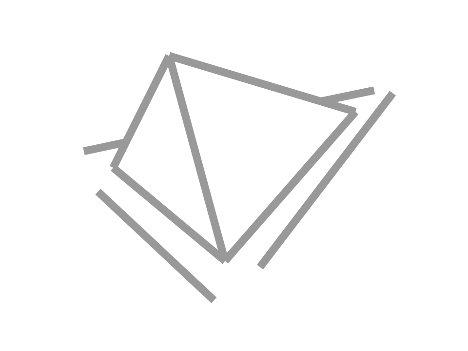

<p align="center">
  
</p>

<h1 align="center">$\nabla$</h1>

Experimenting with lazy functional language implementation from
first principles, with inspiration from Miranda, Haskell, Rust, and various
literatures from SPJ (1987, 1992), Wolfe (1995), and Banerjee (1993).
A secondary goal would be to make it usable as an embeddable language in Rust.

Planned features & non-features:
- simple forward sequenced compile pipeline for now
- not optimizing for efficient compilation for now
- no support for type classes for now
- no support for polymorphic recursion
- inferred types, optional user specified types
- value level variable shadowing
- scoped type variable
- user opt-in strictness [possibly/experimental]
- builtin tabular(arrays/matrices) support to enable tile-based computation [possibly/experimental]
- experimental construct for explicit finite iterations on tabular data + strictness opt-in => enabling polyhedral analysis [possibly/experimental]

## Remaining Todo

- middle-end optimizations on functional Core IR
- STG IR: [some notes on operational semantics](http://github.com/hypersimplex/notes_stg/blob/main/notebook.pdf), [notes on design of STG runtime for this project](http://github.com/hypersimplex/nabla/blob/main/doc/stg.pdf)
- code generation
  - instructions for VM (focus on ease of debugging and instrumentation)
  - native instruction code gen for some parts of the program (eg: convert to CFG and generate via Cranelift, or code gen via custom dialect lowering in Pliron/MLIR framework)
- runtime support
  - VM implementation in Rust
  - hybrid: VM + native instructions

## Sample Snippets

```
data Point {
  x :: Int64,
  y :: Int64,
}

data Circle {
  center :: Point,
  radius :: Int64,
}

classify :: Circle -> String
classify circle = case circle of
  Circle { center = Point { x = Int64 0, y = Int64 0 }, radius = Int64 (1..10) } -> String "Small and centered at (0, 0)"
  Circle { center = Point { x = cx, y = cy }, radius = r } | r > Int64 100 && cx == Int64 10 && cy == Int64 10 -> String "Large and centered at (10, 10)"
  _                                                           -> String "Other"

// built-in ADTs (such as Maybe, Bool, Unit/*currently doesn't support `()`*/, Int64, Float64) are predefined
// data Maybe T = Just T | Nothing
// data Int64 = Int64 Int64#
// data Float64 = Float64 Float64#

scaleCircle factor circle =
  let f :: Int64 = factor
  in case circle of
    Circle { center, radius } -> case radius of
      r | r > Int64 0 -> Maybe.Just (Circle { center = center, radius = r * f })
      _               -> Maybe.Nothing

// data Bool = True | False

isEven :: Int64 -> Bool
isEven n = case n of
  Int64 0 -> Bool.True
  _ -> isOdd (n - Int64 1)

isOdd :: Int64 -> Bool
isOdd n = case n of
  Int64 0 -> Bool.False
  _ -> isEven (n - Int64 1)

add x y = x + y

addTen = add (Float64 10.0)

addFloat :: Float64 -> Float64 -> Float64
addFloat x y = x + y

// explicit annotation
makeAdder :: Int64 -> Int64 -> Int64
makeAdder base =
  let adder x = add base x
  in adder
```
